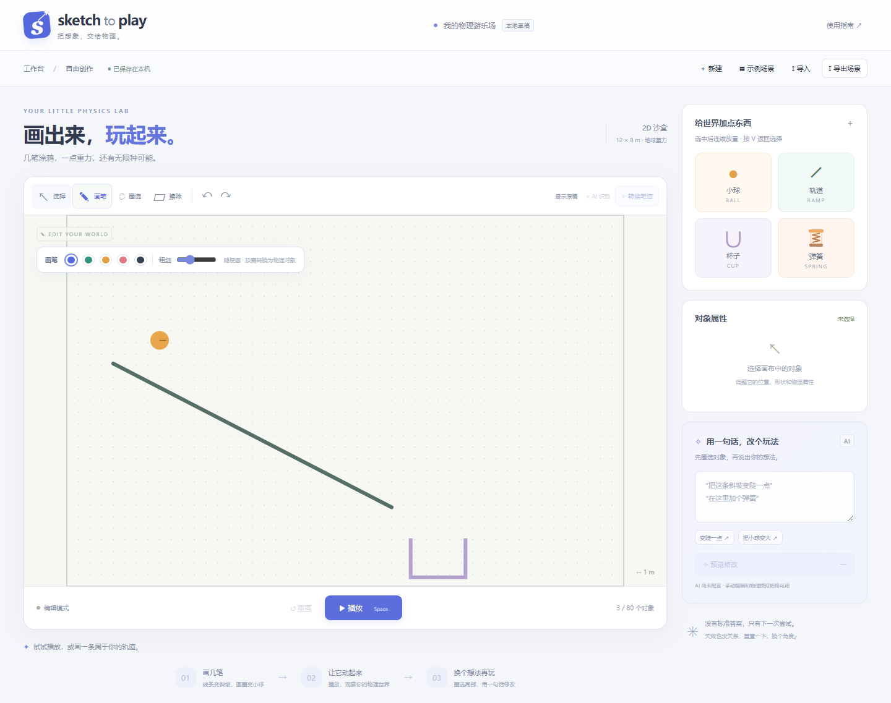

<div align="center">

# sketch-to-play

**画出来，玩起来。**

用几笔涂鸦，搭一个会滚动、碰撞和弹射的二维物理世界。

[快速开始](#快速开始) · [怎么玩](#怎么玩) · [AI 配置](#ai-配置可选) · [开发指南](#开发指南)

</div>



## 这是什么

sketch-to-play 是一个桌面浏览器优先的二维物理沙盒。你可以自由涂鸦，画完即生成有厚度的静态碰撞轨道，或者直接放置小球、轨道、杯子和弹簧，再点击播放，看看它们如何运动。

它既是一个可以反复尝试的小玩具，也是一个无需编程的创作工具：搭一条坡，让球落进杯子；调整弹簧方向，把球送到另一个位置；换个想法，再玩一次。

```text
画几笔 → 立即获得实体轨道 → 播放 → 修改 → 再玩
```

**绘制、手动编辑、物理模拟和保存都可以在本地完成，无需模型密钥。** AI 是可选能力，用于理解笔迹和提出局部修改，不参与逐帧模拟，也不生成并执行任意代码。

## 功能

| 能力     | 当前支持                                               |
| -------- | ------------------------------------------------------ |
| 统一画笔 | 随意画轨道，画完立即碰撞，粗细对应实体厚度             |
| 笔迹转换 | 将可识别的圆、开放折线转换为小球或静态轨道，预览后应用 |
| 物理组件 | 小球、轨道、杯子、弹簧；工具选中后可连续放置           |
| 直接编辑 | 选择、矩形框选、拖动、轨道顶点调整、物理属性修改       |
| 本地模拟 | 重力、碰撞、摩擦、弹性、顶部弹射、越界检测             |
| 反复尝试 | 播放、暂停、继续、重置，以及最近 50 步撤销与重做       |
| 场景保存 | 浏览器自动保存、恢复副本、JSON 导入与导出              |
| 示例场景 | “让小球落进杯子”和“弹簧送球”                           |
| 可选 AI  | 框选对象后用自然语言修改；确认局部图片后识别笔迹       |

## 快速开始

需要 **Node.js 24.x** 与 npm，建议使用桌面版 Chrome 或 Edge。

在项目根目录执行：

```sh
npm ci
npm run dev
```

打开 **[http://127.0.0.1:5173](http://127.0.0.1:5173)**。

开发命令同时启动前端（5173）和 API（8787），前端将 `/api` 请求代理到 API。默认不配置 AI 即可开始创作。停止服务时，在启动终端按 `Ctrl+C`。

## 怎么玩

### 第一个小实验

1. 打开应用，点击 **播放**，观察小球沿坡滚入杯子。
2. 点击 **重置**，回到设计稿初始状态。
3. 选择轨道，拖动白色顶点，或在属性面板中调整位置和摩擦。
4. 再次播放，看看落点发生了什么变化。

也可以在“示例场景”中打开“弹簧送球”，或新建空白场景。

### 一个画笔，自由创作

选择 **画笔**，设置颜色和粗细后随便画。松开鼠标即生成静态实体轨道，直接播放即可让小球落在上面；无需转换，也不调用模型。闭合线、自交线和点也有碰撞厚度，闭合图形内部不填充。需要会动的小球时，从组件面板放置小球。

颜色和粗细同时用于显示和碰撞体；轨道由带圆端点的线段组成。擦除会同时移除笔迹和对应碰撞体，画一笔、擦除或整体移动都可以一次撤销。复杂笔迹会简化，达到场景容量上限时给出提示而不丢失已有场景。

**转换笔迹**保留给旧版未转换笔迹使用；新画笔默认已经是物理对象。

### 放组件与编辑

- 选择组件后连续点击画布放置，按 `V` 返回选择工具。
- 选中对象后拖动位置，或在右侧调节大小、质量、摩擦、弹性和弹射力度。
- 选择工具在空白处拖动也能框选；Ctrl / Shift 点击可增减选择。选中对象有蓝色轮廓、整体边框和数量提示。
- 按 L 使用多选工具画框选中物理对象，松开后可拖动任一选中对象整体移动，也可以一起删除或交给 AI 修改；每次整体移动可一次撤销。多选时不会显示只作用于单个对象的属性表单。
- 拖动轨道的白色顶点改变形状；单段轨道还提供“变陡 10°”预览。
- 杯子有空腔；弹簧有实体外壳和顶板，**小球从上方落到顶板时才会弹射**，侧面与底部只产生普通碰撞。

初始重叠或越界的对象会阻止播放。可按提示手动移动，或使用位置修正预览后再应用。

### 暂停、重置与保存

**暂停**保留本次模拟的位置与速度，继续后从暂停处运行。窗口失焦或切换到后台时会自动暂停。

**重置**清除本次模拟，回到当前已应用设计稿的初始位置，不撤销已确认的编辑。模拟位置不会写回设计稿，编辑前需要重置。撤销和重做作用于编辑事务，不回放物理运动。

场景自动保存在当前浏览器中。刷新可继续编辑，但不恢复模拟进度或撤销历史。不同域名和端口拥有独立存储，例如 `127.0.0.1:5173` 与 `127.0.0.1:8787` 不共享存档。迁移或备份请使用 **导出场景**；清理站点数据会移除本地场景。

### 快捷键

| 按键                   | 操作                     |
| ---------------------- | ------------------------ |
| `V`                    | 选择工具，退出连续放置   |
| `P` / `B`              | 画笔，两者指向同一个工具 |
| `L`                    | 多选（画框选择物理对象） |
| `E`                    | 擦除笔迹                 |
| `Space`                | 播放 / 暂停 / 继续       |
| `Ctrl / ⌘ + Z`         | 撤销                     |
| `Ctrl / ⌘ + Shift + Z` | 重做                     |
| `Delete` / `Backspace` | 删除选中的物理对象       |
| `Esc`                  | 取消预览，或重置当前模拟 |

## AI 配置（可选）

### 接入模型

将根目录 `.env.example` 复制为 `.env`：

```sh
# macOS / Linux
cp .env.example .env
```

```powershell
# Windows PowerShell
Copy-Item .env.example .env
```

填写服务端配置后重启服务：

```dotenv
MODEL_API_KEY=your-server-side-key
MODEL_NAME=your-model-name
MODEL_API_URL=https://api.openai.com/v1/chat/completions
MODEL_SUPPORTS_IMAGES=false
ALLOWED_ORIGIN=http://127.0.0.1:5173
```

代理使用 OpenAI 兼容的 Chat Completions HTTP 格式，要求模型支持 JSON 输出。模型需由部署者实际验证，兼容接口不代表所有模型都支持相同能力。仓库不包含可用密钥，真实模型准确率、时延和成本尚未完成验收。

密钥只配置在服务端，不能放进前端可见的 `VITE_*` 变量或场景文件。`.env` 已加入 Git 忽略列表。

### 两种使用方式

**局部修改**：先选择或框选对象，输入“把小球变大”“把这条斜坡变陡一点”等指令，再预览修改。程序检查目标范围、参数与场景合法性；只有应用后才改稿，可整体撤销。

新增对象需要明确位置：可以先在画布中点击锚点再选择目标，框选时矩形中心会作为锚点。位置不明确或没有空间时，补充位置后重新请求。

**笔迹识别**：模型支持图片输入时设置 `MODEL_SUPPORTS_IMAGES=true`。点击“AI 识别”，确认局部笔迹图后发送；每次最多处理前 20 笔未转换笔迹，结果仍需预览并应用。

请求失败、超时或服务未配置时，原场景保持不变，手动工具仍可使用。取消请求不保证供应商已经停止计费。

### 配置项

| 环境变量                | 默认值                                       | 用途                                  |
| ----------------------- | -------------------------------------------- | ------------------------------------- |
| `MODEL_API_KEY`         | 未设置                                       | 服务端模型凭证                        |
| `MODEL_NAME`            | 未设置                                       | 模型标识；与凭证同时配置后启用 AI     |
| `MODEL_API_URL`         | `https://api.openai.com/v1/chat/completions` | 可信模型服务地址                      |
| `MODEL_SUPPORTS_IMAGES` | `false`                                      | 是否开放图片识别                      |
| `ALLOWED_ORIGIN`        | `http://127.0.0.1:5173`                      | 允许的浏览器请求来源                  |
| `AI_DAILY_BUDGET`       | `1`                                          | 每日预扣额度上限，单位 USD            |
| `AI_REQUEST_RESERVE`    | `0.04`                                       | 单次固定预扣额，单位 USD              |
| `BUDGET_LEDGER_PATH`    | `data/budget.json`                           | 账本路径，相对于 API 进程工作目录     |
| `HOST` / `PORT`         | `127.0.0.1` / `8787`                         | API 与构建后静态站点的监听地址        |
| `API_ACCESS_TOKEN`      | 未设置                                       | 可选 API 访问令牌，供受控反向代理注入 |

额度按 UTC 自然日计量，**每次请求固定预扣且不退回**，并非按供应商实际 usage 结算。部署者应根据价格设置合理的预扣额，并配合供应商硬限额。账本不可读写时停止 AI 调用；当前按单进程设计，不支持多副本共享计量。

## 开发指南

### 技术栈

| 层         | 技术                                    |
| ---------- | --------------------------------------- |
| 界面与工程 | React、TypeScript、Vite、npm workspaces |
| 图形与物理 | Canvas 2D、Rapier 2D / WASM             |
| 数据与校验 | 结构化场景、Zod、IndexedDB              |
| 模型代理   | Node.js、Hono                           |
| 测试       | Vitest、Playwright                      |

```text
apps/
  web/src/             编辑器、画布、物理、本地存储与 AI 客户端
  api/src/             模型代理、校验、幂等、限流与额度控制
packages/core/src/     场景契约、几何、拟合、事务历史与补丁校验
tests/                 核心、物理、API 与浏览器回归
scripts/               性能采样脚本
docs/                  截图、实施状态和测试记录
```

设计稿与模拟运行态分离。编辑先校验再以事务提交；AI 返回受限制的数据补丁，由固定程序解释。新增能力应复用场景模型与物理适配层。

### 常用命令

```sh
npm run dev          # 前端与 API 开发服务
npm run typecheck    # TypeScript 检查
npm test             # 核心、物理与代理测试
npm run test:e2e     # 浏览器回归
npm run build        # 前端生产构建与 API 类型检查
```

首次运行浏览器测试前安装 Chromium：

```sh
npx playwright install chromium
```

也可使用已有 Chrome。Windows PowerShell 示例：

```powershell
$env:PLAYWRIGHT_CHROME_EXECUTABLE='C:\Program Files\Google\Chrome\Application\chrome.exe'
npm run test:e2e
```

测试中的模型响应为模拟数据，不消耗真实模型额度。真实供应商的语义、图像、时延和费用需单独验证。CI 配置见 [.github/workflows/ci.yml](.github/workflows/ci.yml)。

开发服务启动后，可运行满容量采样：

```sh
node scripts/benchmark.mjs
```

脚本测量 80 个对象、30 个球、160 段轨道连续运行 60 秒的情况，写入 `docs/benchmarks/local.json`。历史记录见 [性能报告](docs/benchmarks/REPORT.md)；结果受设备、浏览器和版本影响，不能直接视为当前版本在所有设备上的性能保证。

## 构建与部署

### 单进程运行

```sh
npm ci
npm run build
npm run start -w apps/api
```

打开 **[http://127.0.0.1:8787](http://127.0.0.1:8787)**。API 同时服务 `apps/web/dist` 中的前端资源。启用 AI 时，将 `.env` 中的 `ALLOWED_ORIGIN` 改为实际来源，例如 `http://127.0.0.1:8787`。

当前 API 使用 `tsx` 运行 TypeScript 源码，部署需安装开发依赖，不能使用 `npm ci --omit=dev` 后直接启动。构建脚本对 API 执行类型检查，不生成独立服务端 JS 产物。

### 静态站点

只需本地创作能力时，托管 `apps/web/dist` 即可。未部署 API 时模型入口不可用，绘制、模拟和存档仍可使用。WASM 在首次播放时加载，资源随构建产物提供。

同时需要 AI 时，将同源 `/api/*` 反向代理到 API。公开部署需配置 HTTPS、访问控制和可信代理；`ALLOWED_ORIGIN` 是来源检查，不替代鉴权。当前前端不提供访问令牌输入界面。

## 当前范围

首版聚焦二维创作闭环，目前最多 80 个语义对象、30 个动态球和 160 段轨道。不支持的形状保留为笔迹，不能保证任意草图都转成刚体。

尚未实现完整关卡系统、账号、云同步、多人、作品社区、3D、流体、真实连接弹簧或任意代码执行。多段轨道可手动编辑顶点，AI 暂不支持单段子选择；真实用户试用与真实模型完整验收尚未完成。

详细差异与待验证项见 [实施状态](docs/IMPLEMENTATION_STATUS.md)。

## 参与开发

提交问题时，附上复现步骤、浏览器版本，以及可公开的导出场景 JSON。修改物理或识别行为时，优先增加固定场景或笔迹用例；修改场景契约时同步检查导入导出、撤销和旧文档兼容。

提交前运行类型检查、相关测试与构建。请勿提交 `.env`、模型密钥或包含私人内容的场景文件。

## 项目文档

- [产品需求 PRD](PRD.md)
- [技术方案](TECH_DESIGN.md)
- [实施状态与验收边界](docs/IMPLEMENTATION_STATUS.md)
- [后续产品规划](docs/ROADMAP.md)
- [测试与性能记录](docs/benchmarks/REPORT.md)

弹簧对同一颗球的连续弹射会衰减：每次保留上一次冲量的 70%，弹跳逐渐变低并最终停稳。不同小球独立计算；重置模拟会恢复完整弹力，设计稿中的冲量参数不变。
