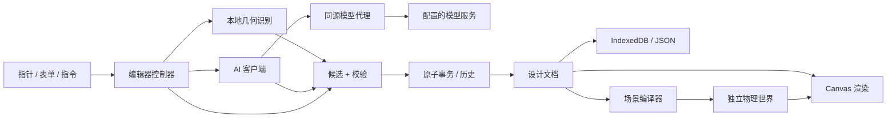
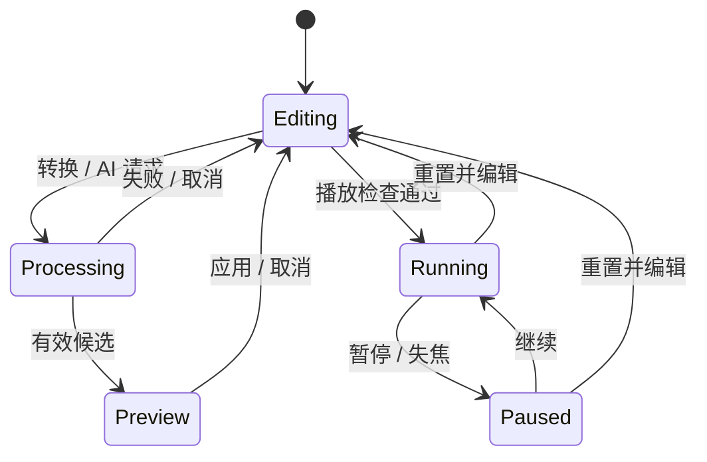

# sketch-to-play · 技术方案

> **以结构化数据连接手绘、编辑与物理，让 AI 成为可替换的意图解释器。**

| 文档信息 | 内容 |
| --- | --- |
| 版本 / 日期 | v0.1 / 2026-11-15 |
| 需求依据 | [PRD.md](./PRD.md)，以其中 P0 与 A01–A16 为验收基线 |
| 当前阶段 | 首期实现与挑战/机关扩展已落地；实测与未验证项见实施状态 |
| 交付边界 | 桌面浏览器、六类组件、固定世界铰链、补画挑战、运动观察、局部 AI、本地存档 |
| 技术主线 | React + TypeScript + Canvas 2D + Rapier 2D + 可选模型代理 |

## 当前实现补充（2026-11-15）

以下章节保留初始技术设计；与实物有差异时，以代码和 [实施状态](docs/IMPLEMENTATION_STATUS.md) 为准。实际模块集中于核心包的 `index.ts`、`challenges.ts`，以及前端的 `main.tsx`、`editor/store.ts`、`canvas/Canvas.tsx` 和 `simulation/physics.ts`，尚未按下方设计目录全部拆分。

- 手绘轨道松开指针即生成静态胶囊线段碰撞体；旧版笔迹保留转换入口。
- `ball`、`block`、`seesaw` 合计最多 30 个动态刚体，矩形轮廓共用于绘制、命中和碰撞。
- `constraints` 支持 `{ id, type: "hinge", bodyId, anchor }`，锚点为世界坐标，引用单个木块。运行时创建固定刚体与 revolute joint；跷跷板内置中心支点，不支持活动物体之间的连接。
- 选中单个木块后，在属性下方添加/移除中心支点。移动时同步平移锚点，删除时清理关联约束，作为同一事务撤销。
- `challenges.ts` 定义五关与固定对象、绘制预算校验；编辑提交处检查规则。入杯低速停留 60 个物理步，时限 30 秒模拟时间。
- 物理步固定 1/120 秒，播放倍率控制累积时间。每 4 步采样实际轨迹，每球上限 1,800 点；暂停单步推进一个物理步。
- 轨迹预测使用独立 Simulation 预演 960 步（8 秒），分批让出主线程。支持取消，设计对象引用改变后预测失效，不提交正式模拟或挑战进度。
- 自由创作仍使用 IndexedDB；挑战草稿、活动关卡与通关记录单独使用 localStorage。清理站点数据会同时移除这些本地数据。

验证覆盖五关固定解法、规则保护、关联删除与撤销、两个连锁示例、30 个带支点动态体稳定性、轨迹隔离及浏览器恢复闭环。结果与限制见 [性能记录](docs/benchmarks/REPORT.md)。

## 01 · 关键决策

1. **场景文档是唯一设计事实来源。** 引擎对象、界面选择和 AI 输出都不能绕过场景事务直接改稿。
2. **设计态与运行态分离。** 每次播放从设计稿创建物理世界；重置销毁世界，再显示设计稿，避免复制速度、弹簧状态等运行数据。
3. **先确定性几何，再 AI。** 本地完成圆、线拟合和参数调整；模型只在用户显式请求时理解局部笔迹或修改意图。
4. **AI 只能提出数据变更。** 不生成可执行代码、不访问文件系统、不自选网络地址；变更必须通过白名单、目标范围和全场校验。
5. **首版主线程完成绘制与模拟。** 80 对象的限制下先测量；仅在实测不达标时迁移物理到 Worker，不提前引入线程通信。
6. **静态应用可独立使用。** 模型代理未部署时照常画、转换、播放、调参和导出；AI 入口说明未配置。

PRD 中的性能、成本与 6–8 周排期仍是待验证目标。本文决定实现路径，不将库提供的 API 等同于产品验收通过。

## 02 · 技术选型与取舍

| 层 | 采用方案 | 原因与代价 |
| --- | --- | --- |
| 工程 | TypeScript strict、Vite、npm workspaces | 共享类型与校验，前端静态构建；两个应用加一个核心包足够，不引入复杂构建编排 |
| UI | React，普通 CSS 与 CSS 变量 | 负责工具栏、表单和状态呈现；不承担逐帧物理更新。选择它便于拆分组件，不要求 SSR |
| 状态 | 核心包中的显式 store + reducer；React 使用 useSyncExternalStore | 避免同时维护框架状态和场景状态；代价是自行实现少量订阅、事务和历史代码 |
| 图形 | 原生 Canvas 2D，DOM 侧栏与工具栏 | 四类基础几何适合直接绘制，易共享碰撞轮廓；自行实现命中检测和手柄，不引入通用绘图编辑器 |
| 物理 | Rapier 2D JavaScript/WASM，先用 rapier2d-compat 验证 | 有 CCD、传感器、刚体与冲量接口；代价是异步初始化、WASM 生命周期和包体积 |
| 契约 | Zod，导出 JSON Schema | 同一来源生成 TS 类型、输入校验和模型结构约束；几何与权限规则另写确定性函数 |
| 存储 | 浏览器 IndexedDB，薄 Promise 封装 | 设计稿、笔迹和恢复副本可在事务中更新；不用 localStorage 存整个文档 |
| 模型代理 | Node.js + TypeScript + Hono，一个进程 | 只管理凭证、供应商适配、限流和预算；不保存用户场景、不建账户系统 |
| 测试 | Vitest + Playwright | 核心算法、无界面物理回归与完整浏览器流程分开验证 |

Vite 提供 React/TypeScript 模板与静态构建流程，见 [Vite 官方指南](https://vite.dev/guide/)。React 官方提供外部 store 订阅接口，见 [useSyncExternalStore](https://react.dev/reference/react/useSyncExternalStore)。这些能力支持上述工程划分，具体效率是本项目的设计判断。

不采用 Next.js 等全栈页面框架：首版没有服务端页面渲染与账号数据需求。暂不引入 PixiJS、Konva 或游戏框架：当前几何和状态规模可用 Canvas 实现，减少图形树与场景文档之间的同步。暂不选择 Matter.js：本方案优先围绕明确的 CCD 路径验证高速碰撞；这不是对其他引擎性能或可行性的否定。

Rapier 官方确认支持动态/固定刚体、CCD，以及多个碰撞体、球、盒、胶囊和传感器；分别见 [刚体指南](https://rapier.rs/docs/user_guides/javascript/rigid_bodies/) 与 [碰撞体指南](https://rapier.rs/docs/user_guides/javascript/colliders/)。上述支持不保证本项目的薄轨道与端点场景一定无穿透，M1 必须实测。

初始化采用官方兼容包的 `await RAPIER.init()` 路径；它把 WASM 编码嵌入 JS，集成简单但有体积代价，见 [安装与兼容包说明](https://rapier.rs/docs/user_guides/javascript/getting_started_js/)。M1 测首载体积；若影响 3 秒目标，再改标准包并配置独立 WASM 资源，不改变核心接口。

开始实施时固定依赖版本和 package-lock.json，使用 Node.js 24.x 作为工程基线，CI 与本地一致。本文不写未经安装验证的依赖版本组合；第一次成功构建后记录实际版本、许可证和浏览器矩阵。

## 03 · 总体架构与目录



```text
apps/
  web/src/
    app/                 页面布局、依赖装配、错误边界
    editor/              工具、指针、圈选、几何手柄
    canvas/              坐标变换、分层渲染、命中检测
    simulation/          Rapier 适配、固定步长、运行态
    persistence/         IndexedDB、导入导出、恢复
    ai/                  请求生命周期、局部图、预览 UI
    examples/            两个模板、完成版、目标元数据
  api/src/
    routes/              capabilities、edit、recognize
    providers/           模型供应商适配器
    policy/              参数限制、预算、幂等与限流
packages/core/src/
  schema/                文档、对象、补丁、常量
  geometry/              拟合、碰撞轮廓、相交、重叠
  commands/              事务、撤销重做、版本
  validation/            结构、语义、可播放检查
  ai/                    意图定义与补丁归一化
tests/
  fixtures/              笔迹、非法补丁、物理初始条件
  e2e/                   用户闭环与故障注入
docs/benchmarks/         设备、版本、性能和成本报告
```

核心包不能依赖 React、浏览器 DOM 或 Rapier。`geometry` 输出可序列化碰撞基元，渲染、命中、校验与物理编译共用它，避免“看上去没碰上，引擎却已经接触”。物理适配器不暴露引擎句柄给 UI。

## 04 · 数据契约与不变量

### 4.1 文档与运行数据

保留 PRD 的 JSON 字段与坐标约定：米、千克、秒，世界原点左下，x 向右、y 向上，角度存弧度，界面显示角度。`SceneDocument` 包含 `schemaVersion`、`sceneId`、`revision`、`world`、`objects`、`constraints`、`objectives`。

采用以 `kind` 区分的严格联合类型，不允许任意属性对象：

| kind | shape | transform 与 physics |
| --- | --- | --- |
| ball | circle：radius | 可旋转的动态球；mass、friction、restitution、collisionEnabled |
| track | polyline：points、thickness=0.08 | 静态轨道；points 为局部坐标，至少两点 |
| cup | cup：innerWidth、innerHeight、wallThickness=0.08 | 静态；rotation=0；位置为外轮廓底边中心 |
| spring | launcher：baseWidth=0.4、baseHeight=0.12、triggerDepth=0.08 | 静态；位置为底座中心，rotation=0；方向在 behavior 中单独保存 |

弹簧 `behavior` 为 `{type:'launcher', direction:[dx,dy], impulse, cooldown:0.3}`，方向必须为非零单位向量。固定底座不跟随方向旋转，箭头表达弹射方向。球与轨道仍可加载 PRD 中的示例。

`collisionEnabled` 是数据兼容字段，P0 各组件均要求 true，不提供穿墙开关。P0 `constraints` 只能为 `[]`；目标采用有限的 `{type:'ballInCup', ballId, cupId, enabled}`，不能执行表达式。删除目标对象时，同一事务将目标置为 disabled 并保留说明字段；这是宿主对派生目标状态的维护，不扩大 AI 的对象修改权限。

编辑附属数据采用文件信封，兼容 PRD 的纯场景输入：

```ts
type ProjectFile = {
  fileVersion: 1;
  scene: SceneDocument;
  strokes: Stroke[];
  sourceTemplateId?: string;
};
type Stroke = {
  id: string;
  points: Array<{ x: number; y: number; t: number }>;
  status: 'pending' | 'converted';
};
type RuntimeState = {
  runId: string;
  sourceRevision: number;
  simulatedSeconds: number;
  transforms: Map<string, { x: number; y: number; angle: number }>;
  escapedIds: Set<string>;
};
```

导出统一使用 ProjectFile；导入支持 ProjectFile 或 PRD 纯 SceneDocument，后者补空笔迹，不改变物理。允许 sourceStrokeIds 指向未附带的源笔迹，但给出“原笔迹不可用”信息；不将这种情况当作物理引用断裂。

### 4.2 限制与校验分级

`limits.ts` 统一提供 PRD 的半径、质量、冲量、数量和速度限制，UI、Schema、代理校验和测试全部引用，禁止各自写一份。

除 PRD 限制外增加防资源耗尽上限：单场 200 笔、每笔 2,000 采样点、总计 50,000 点；导入文件最多 2 MiB，JSON 嵌套深度最多 16。采样时在线简化，达到上限停止当前笔并提示。物理碰撞体总数上限先定 512，含边界和传感器，M1 压测后可收紧。

校验返回 `{code, severity, objectIds, fieldPath, message, suggestedAction}`，按三层处理：

| 层 | 示例 | 结果 |
| --- | --- | --- |
| 文档合法性 | 重复 ID、NaN、未知字段、负尺寸、超限、非法约束 | 禁止应用、保存或替换导入 |
| 可播放性 | 初始穿插 >0.01 米、轮廓越界 | 可预览、可保存编辑稿，禁止播放；AI 候选不可应用，先修正候选 |
| 玩法警告 | 杯口过窄、只有静态对象 | 提示但不阻止播放 |

直接拖动可以暂时产生不可播放设计稿，让用户继续修改；非法结构永远不能进入设计稿。导入合法但不可播放的稿件允许进入编辑修复。AI 更严格：候选需通过合法性和可播放性两层后才能应用，且不自动挪动未选对象。

Zod 负责结构与基础范围；ID 唯一性、选择权限、相交和跨字段关系使用核心函数。Zod 官方支持 JSON Schema 导出，但部分类型无法表达；因此模型 Schema 使用纯 JSON 类型，复杂检查保留在宿主端，见 [Zod JSON Schema](https://zod.dev/json-schema)。

## 05 · 状态管理、事务与版本

### 5.1 状态机



只有 Editing 能提交设计变更。拖动期间在临时交互层更新，pointerup 才形成一次事务；pointercancel/失去捕获恢复起点。Processing 锁设计编辑，保留取消。Preview 中修正候选只更新候选分支。

React 订阅文档、模式、选择和提示等低频状态。运行坐标存在物理控制器内，Canvas 每帧直接读取；不把每帧坐标写入 React store。store 的快照引用在未变更时保持稳定。

### 5.2 原子提交

```ts
type Transaction = {
  id: string;
  baseRevision: number;
  label: string;
  before: DesignContent;
  after: DesignContent;
};
// DesignContent 包含场景内容与笔迹，不含 revision 和运行态。
```

提交步骤：读取当前版本 → 克隆候选 → 执行命令 → 校验 → 对比实际差异 → 一次替换场景和笔迹 → revision 加一 → 写入 undo 栈 → 触发自动保存。任一步失败原稿不变；空差异不生成历史、不递增版本。

P0 使用最多 50 条 before/after 快照，比自制通用反向补丁更容易验证；笔迹与未改对象使用不可变结构共享，避免内存重复。撤销恢复 before 的内容，重做恢复 after 的内容，但 revision 总是递增。分支编辑清空 redo。sourceStrokeIds、笔迹转换状态和派生目标禁用状态必须一起撤销。

`sceneId + revision + sessionEpoch + requestId` 共同识别 AI 结果：sessionEpoch 在导入、新建、切换场景时递增，即使加载旧文件的 sceneId/revision 相同，旧请求也不能生效。

## 06 · 画布、手绘与选择

### 6.1 坐标与渲染

画布可用区宽高为 W/H，世界为 12×8 米：`scale=min(W/12,H/8)`；留白居中。屏幕 CSS 坐标为 `sx=offsetX+x*scale`、`sy=offsetY+(8-y)*scale`。所有指针坐标先减 canvas bounding rect，再逆变换。Canvas backing store 乘 devicePixelRatio，绘制使用 CSS 像素；DPR 初始封顶 2，防止高分屏过大。

单 Canvas 按顺序绘制背景网格、对象、原笔迹、候选差异、选择轮廓和手柄。编辑态按 dirty 标志重绘，模拟态 requestAnimationFrame 重绘。运行期间仅改变球的变换；轨道、杯子和弹簧几何缓存。文字和按钮尽量使用 DOM，提供键盘焦点和屏幕阅读器标签。

### 6.2 手绘识别流水线

1. Pointer Events + pointer capture 收集世界坐标，按距离合并近点，过滤重复点。
2. 计算包围盒、长度、端点距离、自交数量，过短笔迹保留但不转物体。
3. 对直线做主方向拟合，以最大垂距/包围盒对角线衡量误差；阈值初值 5%。
4. 对近闭合笔迹拟合圆，以平均径向误差/拟合半径衡量误差；阈值初值 12%，端点距离不超过周长估计的 10%。
5. 开放折线使用 Ramer–Douglas–Peucker 简化，epsilon 初值 0.03 米；检查最短段 0.15 米与总段数限制。
6. 明显 U 形给杯子候选；螺旋只提示弹簧候选，不把螺旋线直接当碰撞体。闭环不规则、自交或候选接近时要求选择。
7. 所有候选进入统一预览，仍需应用，不能因误差低自动改稿。

阈值是调参初值；用 A02/A03 固定笔迹集验证，保留原始笔迹以便复现。拆分笔迹由用户点选分割位置，产生两个待转换片段；这是编辑操作而非自动多笔语义组合。

### 6.3 命中与圈选

命中容差使用屏幕 6 像素换算到世界，不改变物理尺寸。先做包围盒粗筛，再做圆、胶囊、矩形的精确测试。点击候选按显示层序排序，短时间同位置再次点击循环选择。

圈选多边形与对象中心、碰撞轮廓做相交测试，包含轮廓被完全圈住与圈选区域被轮廓包住的情况；杯子测试三面而非外包围盒，避免杯中空白被误认为实心。传感器轮廓只在选择/编辑弹簧时可见，命中仍映射回同一个 spring ID。

斜坡的“单段选择”是 `{objectId, segmentIndex}` 子选择，已有对象权限仍按 objectId 检查，补丁只允许更新指定段关联的点，并在预览展示相邻段受到的影响。点击端点附近优先命中手柄。

## 07 · 物理编译与模拟

### 7.1 单一几何编译

```ts
interface PhysicsAdapter {
  create(scene: SceneDocument): void;
  step(dt: number): void;
  readTransforms(): ReadonlyMap<string, RuntimeTransform>;
  drainEvents(): RuntimeEvent[];
  destroy(): void;
}
```

`compileGeometry(object)` 生成圆、胶囊、盒与触发矩形。渲染碰撞轮廓、初始重叠检测和物理创建使用同一输出：

| 组件 | 编译方式 | 注意事项 |
| --- | --- | --- |
| 球 | dynamic body + circle collider，开启 CCD | 按目标质量设置密度 `mass/(πr²)`，避免再叠加一次附加质量；初始线速和角速均为零 |
| 轨道 | fixed body + 每段一个半径 0.04 米的 capsule collider | 端点圆滑、无零厚度线；每段转到对应方向，半长为端点距离的一半 |
| 杯子 | fixed body + 三个 cuboid collider | 内宽内高定义空腔，左右壁和底板在空腔之外，口朝上 |
| 弹簧 | fixed body + 底座 cuboid + 顶部 sensor cuboid | sensor 不产生实体碰撞，触发逻辑独立于底座 |
| 世界边界 | 左、右、底部 fixed cuboid | 内表面分别在 x=0、x=12、y=0；顶部无墙 |

摩擦、弹性映射为碰撞体属性，并显式固定混合规则为平均，回归测试记录规则。几何生成顺序按对象文档顺序固定；引擎 handle 通过 map 映射对象 ID，不进入存档。

初始重叠用圆与圆、圆与胶囊、圆与盒的解析距离，静态体相互重叠允许。只对有实体碰撞的基元阻塞，不把弹簧触发区当重叠错误。检测也包含世界边界。M1 检查解析轮廓与引擎调试轮廓一致。

### 7.2 固定步长

固定 `dt=1/120s`，使用 rAF 的时间累计器，每帧最多推进 8 步：

```text
frame(now):
  如果非运行态：不推进
  累计经过时间；单帧最多计入 8*dt
  最多重复 8 次：
    处理上一步已排队冲量，限制速度
    world.step(dt)
    更新弹簧、越界、目标与异常检查
    simulatedSeconds += dt
  用最近两个运行变换按 accumulator/dt 插值绘制
```

超过单帧预算的真实时间丢弃，模拟变慢但不积累无限补算任务；连续 2 秒过载提示场景过重。暂停、blur、visibilitychange hidden 清空累计器；继续时重置 lastTimestamp，保持物理速度，避免恢复时突然多步快进。目标计时和冷却采用模拟时间。

播放异步初始化引擎时显示加载状态，只允许一个初始化 Promise；失败回编辑并保留设计。重置清除 rAF、事件队列、插值缓存、目标状态、pair 状态和世界资源。UI 卸载也走同一幂等 destroy，防止 React 开发环境重复挂载产生双循环。

### 7.3 弹射器

维护 `(springId, ballId) → {inside, armed, lastFireTime}`。首次接触触发区且 armed、冷却已过时，按 `J=direction*impulse` 对球心施加冲量并唤醒；随后 armed=false。必须检测到离开后才能重新 armed；再次进入时冷却不足，本次停留不触发。

传感器事件作为候选，再用共享几何检测确认。考虑传感器在高速运动下可能漏掉进入/离开，前后两帧球心线段对按球半径膨胀后的触发矩形做扫掠检测，不假设实体 CCD 自动解决 sensor 漏触发。检测到的冲量排队到下一固定步处理，不在引擎回调中修改世界。多个弹簧同一步作用时按 spring ID 排序合成冲量，再限速 12 m/s。

### 7.4 稳定性与玩法目标

每步检查球位置、速度为有限数；冲量后和步进后均限制速度。CCD、速度限制和子步进共同使用，不能将任何一项视为穿透证明。达到安全域外侧（画布四边向外扩 1 米）将球标记 escaped 并移除物理实体，保留最后显示位置与越界提示，其他对象继续。

目标每步检查球圆心在杯内腔、整个球低于杯口且速度 <0.3 m/s；连续满足 60 个 1/120 秒步长则成功一次。任何不满足立即清零计时。目标对象不存在或禁用则跳过。

“画坡入杯”分别维护不完整引导模板、建议区域和补好坡的标准完成版；A15 的稳定成功测试运行标准完成版，“先看一次”也加载完成版，避免要求不完整模板自动成功。

自动移开重叠采用固定方向和距离顺序，0.01 米步距在 0.3 米半径内搜索，最近距离优先，同距按固定角度顺序。输出位置候选，不直接挪动；不扩大半径、不移动其他对象。

## 08 · AI 协议、校验与预览

### 8.1 服务与供应商边界

首版实现一个可配置供应商适配器，通过 `ModelProvider` 隔离调用：

```ts
interface ModelProvider {
  edit(input: EditModelInput, signal: AbortSignal): Promise<ModelResult>;
  recognize(input: RecognizeModelInput, signal: AbortSignal): Promise<ModelResult>;
}
// ModelResult 包括 unknown 类型的 payload、usage 与实际模型标识。
```

部署配置明确选一个实际模型，要求支持中文指令、局部图输入及 JSON 结果。M4 通过 30 条指令与图像样例后记录供应商、模型快照和价格；未完成前不承诺某个模型达到目标。不实现多模型自动路由。供应商若提供结构化输出则使用，但仍执行宿主校验；不支持图像时只禁用 AI 草图入口，不影响文本修改。

### 8.2 HTTP 接口

| 接口 | 输入 / 输出 | 约定 |
| --- | --- | --- |
| GET /api/capabilities | AI 是否配置、支持图像、公开模型名称、可用额度状态 | 不返回密钥、内部地址或余额明细 |
| POST /api/ai/edit | 指令、选择集、锚点、版本、场景摘要 → 补丁或澄清 | 请求体上限 128 KiB，不包含原笔迹图片 |
| POST /api/ai/recognize | 选中笔迹局部 PNG、坐标映射、允许类型 → 对象候选 | 最长边 1024 像素，请求体上限 2 MiB，解码后再验尺寸 |

请求公共字段：`requestId`、`sceneId`、`baseRevision`、`sessionEpoch`、`targetIds`。文本修改只发选中对象完整数据、至多 20 个邻居的只读摘要、当前世界边界，不上传原始全稿。局部图仅渲染选中笔迹，移除侧栏和文本输入；上传前可见预览。

图像映射包含裁剪区左上世界位置、每像素米数和 y 轴方向；模型输出图像归一化坐标，由宿主统一映射为世界坐标，不能凭屏幕像素直接建物体。

响应采用有限联合：`ok`、`needsAnchor`、`needsClarification`、`unsupported`。模型只填写业务内容，代理将 requestId 等信封字段从已验证请求回填，模型不能自报新版本或替换目标 ID。

错误使用固定代码：`NOT_CONFIGURED`、`RATE_LIMITED`、`BUDGET_EXCEEDED`、`TIMEOUT`、`INVALID_MODEL_OUTPUT`、`INVALID_PATCH`、`STALE_REQUEST`、`UPSTREAM_ERROR`。UI 按代码展示行动建议，不直接显示供应商原始错误或堆栈。

### 8.3 补丁格式

```json
{
  "status": "ok",
  "requestId": "req-123",
  "baseRevision": 7,
  "targetIds": ["ball-01"],
  "operations": [
    {
      "type": "updateObject",
      "objectId": "ball-01",
      "changes": { "shape": { "type": "circle", "radius": 0.25 } }
    }
  ],
  "explanation": "将球的半径从 0.20 米改为 0.25 米。"
}
```

changes 按 kind 定义可更新字段，不采用任意 JSON Pointer。shape/transform 以完整子对象替换，避免深层 merge 歧义；禁止 prototype 相关字段、未知 key、变更 id/kind/bodyType。`addObject` 使用无最终 ID 的完整对象描述，由宿主创建 ID；P0 不允许后续操作引用本次新增临时对象。重复修改同一对象、先删后改等含糊操作整组拒绝，提示拆成两次请求。

### 8.4 确定性语义与应用流程

“变陡一点”由模型解释为有限意图 `steepenSegment`，宿主按 PRD 规则计算成 updateObject，不让模型自由生成角度。固定低端点、保持长度，坡度绝对值增加 10°并限制 5°–75°；水平段缺少高低端时固定左端为低端，预览明确说明。相邻段因共享点改变也必须在差异中展示。

新增物体检查整个实体轮廓是否位于确认圈选区域或锚点 1 米邻域，不能只检查中心点。“球下加弹簧”先从球底部推导底座位置并检测重叠；无空间时要求移动锚点，不能静默移球。

```text
响应到达
→ 检查当前请求身份、场景会话与版本
→ 严格解析 JSON / Schema（拒绝额外自然语言包裹）
→ 检查目标存在、已有对象修改范围、子选择、新增区域、操作数量
→ 在副本应用补丁并执行目标状态维护
→ 全场结构、容量、几何与可播放性校验
→ 从实际 before/after 计算可视差异
→ 用户检查候选，修正后重新校验
→ 应用前再次检查身份与版本，原子提交
```

预览显示真实计算的尺寸、位置和角度差值；模型 explanation 只作说明，不能代替真实差异。任意非法操作使整组失败，不静默截断参数。没有变更时显示“无需修改”，不生成空事务。

### 8.5 取消、重试与额度

客户端 AbortController 在取消或 20 秒总期限时中止请求并回编辑；代理最长处理 18 秒，SDK 自动重试设为 0。取消不保证供应商已经停止计费，界面不承诺退款。迟到响应按四元身份检查丢弃。

同一会话仅一个在途请求。代理以访问者会话与 requestId 缓存在途/完成状态 10 分钟，重复提交返回同一状态，不能再次计费调用；用户主动重试生成新 requestId。

首版代理采用单进程部署，限流初值每访问者每分钟 6 次、全局并发 2。私有部署可用访问令牌；公开部署必须在反向代理层限制访问并启用额度，不将客户端按钮禁用视为服务端限流。

日预算使用磁盘账本，以单进程锁预留本次最大输出与输入成本，成功后按 usage 结算；无 usage 的超时按预留额计入。重启恢复账本，账本不可写则停止 AI 调用。供应商支持硬限额时同步配置。单进程限制不满足多副本部署，扩容前再换共享计量存储；MVP 不部署多副本。

## 09 · 本地存储与文件生命周期

IndexedDB 采用四个 store：`documents`（当前项目）、`recoverySnapshots`（每场最近 5 个）、`drafts`（待转换笔迹恢复）、`meta`（当前场景和数据库版本）。IndexedDB 提供事务式存储；写入成功以事务完成为准，而非单个 put 请求成功，见 [IndexedDB 使用指南](https://developer.mozilla.org/en-US/docs/Web/API/IndexedDB_API/Using_IndexedDB)。

保存器 500 毫秒防抖，单队列串行写入。每次捕获不可变文档和 revision；事务内更新当前设计、笔迹关联数据与恢复副本，并清理超出 5 份的副本。旧保存完成时，只有 `savedRevision === currentRevision` 才显示已保存，否则继续保存新版本。笔迹变更额外使用 draftSequence，不用场景 revision 判断笔迹是否已落盘。

每个写事务读取 storedRevision，以预期版本做比较，检测其他标签页更新；BroadcastChannel 用于尽早提示，但不是一致性保证。发生冲突时停止覆盖，提示另存本地副本或导出，不自动合并。为临时“另存”生成新 sceneId。

加载先验证当前文档；损坏时按时间倒序找恢复副本，显示恢复来源；全部无效则保留损坏数据供下载，不自动删除。存储不足或权限失败保留内存并显示未保存。beforeunload 仅提醒未保存，不能依赖关闭事件完成异步写入。

导入先检查文件字节大小，解析为 unknown，再 Schema 校验及迁移；通过预览后切换。新建/导入/示例切换均先 flush 当前稿，失败则保留当前页面并提供导出或主动放弃。模板文件只读，用户修改产生独立 sceneId。导出用浏览器 Blob，UTF-8 JSON，不把密钥、AI 指令历史、运行坐标或引擎句柄装入文件。

数据库升级与场景 schemaVersion 分开。迁移函数按 vN→vN+1 链式执行，输出重新校验，失败保留原文件；第一版拒绝未来版本，不用 AI 修复。

## 10 · 安全、部署与运行观测

### 10.1 部署方式

- **本地工具模式**：构建 apps/web，任何合适静态服务器托管；无 AI，所有核心操作在浏览器完成。首版不承诺离线安装/PWA。
- **含 AI 模式**：一个 Node 进程服务静态资源和 /api，或反向代理转发同源 /api；凭证只在服务端。开发时 Vite 代理到本地 API。
- **配置项**：服务端 `MODEL_PROVIDER`、`MODEL_NAME`、`MODEL_API_KEY`、`AI_DAILY_BUDGET`、`ALLOWED_ORIGIN`、`BUDGET_LEDGER_PATH`；可选供应商 URL 仅由部署管理员配置，不接受客户端提供 URL。

Hono 提供 Node.js 部署适配，见 [Hono 官方说明](https://hono.dev/docs/getting-started/nodejs)。生产构建不暴露 `MODEL_*` 变量，不使用前端可见环境变量存密钥；部署检查构建产物是否出现测试密钥。

只允许同源请求，验证 Origin 和 Content-Type、请求体大小与访问凭证；CORS 不是鉴权。文本按纯文本渲染，禁止 dangerouslySetInnerHTML，导入不允许外部资源 URL。模型没有工具调用权限，不能从指令获得代码执行能力。

### 10.2 观测

默认不上传场景和操作轨迹。浏览器开发诊断记录输入反馈、转换耗时、物理步时、帧间隔与保存失败；生产只提供本地诊断导出，用户主动选择后才携带场景。

代理日志仅记录 requestId、耗时、模型标识、token/图像用量、估算成本、状态码，不记指令、图片、密钥或完整响应。日志中的成本以配置价格计算，报告同时注明币种、价格日期和换算方式，实际账单为准。

## 11 · 测试、性能与验收映射

测试框架采用 [Vitest](https://vitest.dev/guide/) 与 [Playwright](https://playwright.dev/docs/intro)。核心测试验证不变量和真实失败路径，UI 测试覆盖完整任务，不为每个 getter 或颜色样式单独写测试。

| 测试层 | 必测内容 | PRD 对应 |
| --- | --- | --- |
| 核心单测 | 坐标往返、拟合误差、圈选包含与相交、碰撞深度、参数边界 | A02/A03/A06/A10 |
| 事务测试 | 原子失败不改稿、连续 50 步撤销重做、revision 递增、笔迹和目标一起恢复 | A07/A08/A14 |
| 引擎集成 | 球/杯/轨道/弹簧、CCD 边角、高速触发扫掠、暂停与重置、无效数值 | A04/A05/A11/A12 |
| 数据集成 | 导出导入等价、配额失败、升级失败、恢复副本、多标签冲突、旧保存迟到 | A10/A13 |
| API 故障 | 畸形输出、越权、超时、断网、取消迟到、重复 requestId、额度账本失败 | A07/A09 |
| 浏览器流程 | 手绘→转换→播放→重置→局部修改→撤销→保存恢复 | A01/A08/A13 |
| 示例回归 | 两个标准完成版各 20 次，目标计时与删除处理 | A15 |
| 实测报告 | 参考设备上的时延、FPS、首载、请求成本和 5 人观察 | A01/A16 |

固定 100 个穿透初始条件，覆盖最小球、最大速度、轨道端点、折角、斜入杯壁和边界。结果以球是否从障碍物一侧越过另一侧且无合法绕行路径判断，不只检查最终位置。每次更改引擎版本、时间步、碰撞体形状或速度上限都重跑。

AI 在日常 CI 使用录制的合法/恶意响应，不消耗真实模型额度；M4 与发布前手动运行真实 30 条语义集和至少 50 次时延样本，并记录调用成本。模拟物理测试使用固定场景与构建顺序，断言容差和是否成功，不要求浮点字节级一致。

### 性能预算与优化触发

沿用 PRD：本地输入 P95≤50ms、20 笔拟合 P95≤300ms、播放/重置 P95≤200ms、满额场景 60 秒帧间隔 P95≤25ms、冷首载≤3s、加载≤1s。AI P50≤4s、P95≤10s、20s 超时，10 分钟中位成本≤¥0.20 均待实测。

先做三项诊断：物理子步总耗时、Canvas 绘制耗时、React 提交耗时。单独物理长期占帧预算一半以上才评估 Worker；绘制超时先减少分配、缓存静态层；UI 超时先排查逐帧 store 更新。Worker 不改变核心场景契约，只把控制器变为消息适配器，使用 runId 丢弃旧世界结果。

每次发布记录 hardware/browser/dependency/model/network 条件，P95 统计说明预热、采样和异常样本处理。不得用开发服务器性能替代生产构建测量，也不得将 AI 断网回退算成成功请求。

## 12 · 实施任务与交付顺序

| 阶段 | 实施任务 | 可检查产物 / 出口 |
| --- | --- | --- |
| M0 · 工程与契约 | npm workspace、TS strict、Schema、limits、状态机、坐标与文档事务 | PRD JSON 可加载；非法文档有字段错误；基础构建/类型检查通过 |
| M1 · 物理验证 | Rapier 初始化与释放、共享几何、四组件、固定步长、重置、CCD、触发扫掠 | 手工 JSON 演示；A04/A05/A11；满额场景基准报告，决定是否接受引擎 |
| M2 · 编辑闭环 | 布局、Canvas 输入、拟合预览、圈选、手柄、属性、两个示例 | 无模型完成首次一分钟；A02/A03/A06 与标准完成版回归 |
| M3 · 数据可靠性 | 50 步历史、自动保存、恢复副本、导入导出、多标签冲突 | A10/A13/A14；失败注入报告 |
| M4 · AI 局部修改 | 代理、Provider、结构输出、意图归一化、局部图、校验、差异预览、计量 | A07/A08/A09；30 条语义集、至少 50 次时延样本 |
| M5 · 发布 | 5 人观察、性能复测、限额部署、README、示例、已知限制、许可证清单 | 全部 P0 验收有证据；未达 AI 目标披露实际限制 |

建议工程脚本约定：`npm run dev` 启动前端与本地代理，`npm run build` 构建两应用，`npm run typecheck` 校验全部包，`npm test` 运行核心与物理回归，`npm run test:e2e` 运行浏览器闭环。它们是待实现接口，当前仓库尚不能执行。

第一批实现按“加载 PRD JSON → 显示碰撞轮廓 → 播放 → 暂停 → 重置”切片完成。接着补四类组件与穿透测试，再接手绘。M1 未通过前，不建设真实模型接入或 P1 组件。

## 13 · 待验证项与变更门槛

| 不确定项 | 验证节点 | 不满足时如何处理 |
| --- | --- | --- |
| 兼容包首载体积 | M1 生产构建与网络节流 | 换标准 WASM 资源加载并复测，不凭经验承诺体积 |
| CCD + 1/120s 是否覆盖边角 | M1 固定 100 场景 | 调整求解/步长，收紧速度后同步修改 PRD 与 limits；仍失败则重新评估引擎 |
| 胶囊轨道折角是否卡球 | M1/M2 接缝测试 | 调整简化与连接几何，保持渲染和碰撞一致，不隐藏卡点 |
| 鼠标拟合阈值 | M2 笔迹集与首次试用 | 调整阈值和候选修正，不扩大成任意形状识别 |
| 模型语义、时延和成本 | M4 固定指令、图片和真实调用 | 缩上下文、优化指令及直接操作引导；必要时延后 AI 发布，不声称完整 P0 已完成 |
| 50 条快照的内存开销 | M3 最大笔迹/对象场景 | 不可变结构共享，必要时再换可逆补丁，保留事务语义 |
| 目标设备主线程帧率 | M1/M5 压测 | 先定位瓶颈，再决定 Worker；不提前扩为多线程引擎框架 |

任何影响用户可见语义的调整（组件范围、参数上限、AI 应用条件、重置和保存行为）必须同步更新 PRD、技术常量与验收用例。新增库先说明解决的已测问题与替代成本；新增组件、联网分享、真实连接弹簧和关卡系统另立需求，不混入首版实现。

---

**技术交付标准：** 设计稿可独立校验、编辑事务可撤销、模拟可重建、模型结果可拒绝、失败后用户数据仍在；本地创作闭环不需要模型在线。
